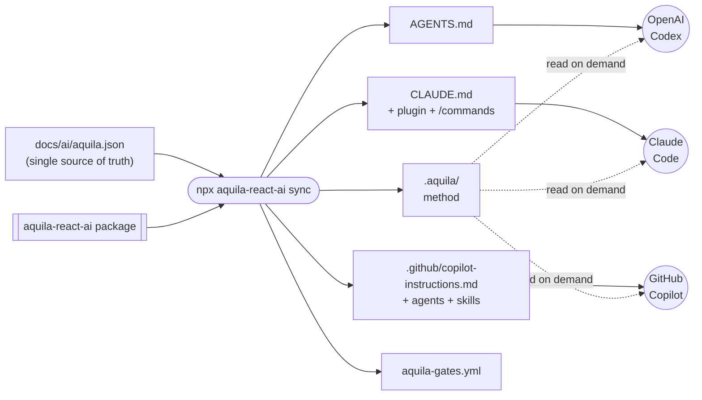
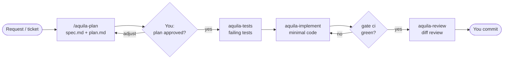
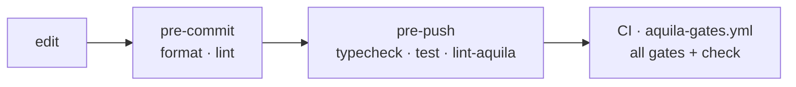
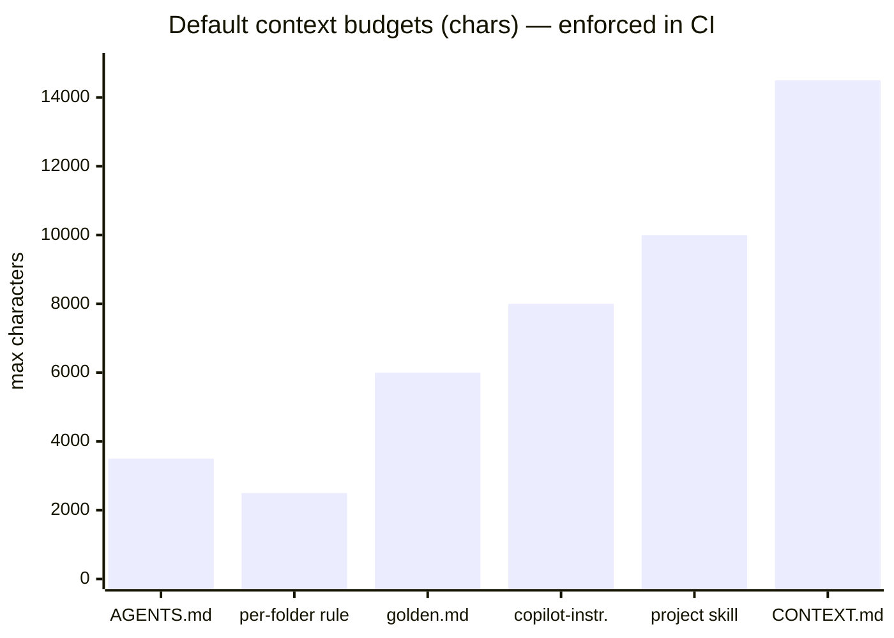

<p align="center">
  
</p>

<h1 align="center">aquila-react-ai</h1>

<p align="center">
  <b>Give your AI coding agents an eagle's eye.</b><br/>
  A battle-tested, spec-driven development method for <b>React</b> — one install, the same discipline in
  <b>Claude Code</b>, <b>GitHub Copilot</b> and <b>OpenAI Codex</b>.
</p>

<p align="center">
  <a href="https://www.npmjs.com/package/aquila-react-ai"></a>
  
  
  
  
  
  <a href="LICENSE"></a>
</p>

---

Version **0.2.0**

## Why aquila-react-ai?

AI agents write code fast. Left alone, they also **skip tests, sprinkle `useEffect` everywhere, forget
loading and error states, ignore accessibility, use React APIs that don't exist in your version, open
80-file PRs and burn through your token budget** re-reading the whole repo.

aquila-react-ai turns any agent into a disciplined teammate:

| Without a method | With aquila-react-ai |
|---|---|
| The agent starts coding straight from a vague prompt | A **spec + 6-section plan**, then a hard stop until you say `plan approved` |
| Tests written after the fact (or never) | **TDD**: failing tests first, minimal code, gates green before "done" |
| Generic TypeScript that ignores React idioms | **Official React conventions**, version-aware (17 → 19.3, focus on **18 and 19**), framework-aware (Vite, Next.js, React Router) |
| Every tool configured differently | **One method** for Claude Code, Copilot and Codex, generated from one config |
| 2,000-line context files loaded on every prompt | **Token economy**: ≤ 3.5 KB always loaded, the rest read on demand |
| Huge PRs approved out of fatigue | **Small-PR directive**: above 30 files (configurable) the agent proposes incremental PRs |
| "Works on my machine" | **Gates** in git hooks and a generated GitHub Actions workflow |
| Docs that rot | **Doc-sync** checks: C4, ADRs and tracks updated in the same task |

## Install in 60 seconds

```bash
npm i -D aquila-react-ai
npx aquila-react-ai init
```

Then ask your agent for **`/aquila-init`**. It reads your codebase, confirms six choices with you and writes
the documentation the agents will rely on. That's it: `/aquila-plan` is ready.

## What lands in your project

`init` scaffolds the full AI structure, versioned with your code so teammates **and cloud agents** get it
on clone:

```text
your-react-app/
├── .aquila/                         ← the method (rules, roles, skills, React conventions) — synced from the package
│   ├── core/  skills/  agents/  adapters/  schema/  .claude-plugin/
├── docs/
│   ├── ai/  CONTEXT.md · golden.md · aquila.json · skills/     ← what agents must know about YOUR project
│   ├── c4/  adr/  tracks/  reference/  runbooks/
├── .github/
│   ├── instructions/*.instructions.md                         ← per-folder rules (native in Copilot)
│   ├── copilot-instructions.md
│   └── workflows/aquila-gates.yml                             ← CI gates, generated
├── .aquila-hooks/                                            ← git hook dispatcher, shared by every aquila package
├── AGENTS.md  ·  CLAUDE.md                                    ← tiny routers every agent reads first
└── .claude/commands/aquila-*.md                               ← slash-command shortcuts
```

## One method, three agents



| | Claude Code | GitHub Copilot | OpenAI Codex |
|---|---|---|---|
| Entry point | `CLAUDE.md` → `AGENTS.md` | `copilot-instructions.md` + `AGENTS.md` | `AGENTS.md` |
| `/aquila-*` commands | ✅ plugin skills + shortcuts | ✅ `chat.agentSkillsLocations` | ✅ "aquila-plan …" |
| Roles (plan/tests/implement/review) | ✅ plugin agents | ✅ custom agents with handoffs | ✅ read as files |
| Per-folder rules | ✅ via the context map | ✅ native `.instructions.md` (also PR review) | ✅ via the context map |
| Guard against `--no-verify` / force push | ✅ PreToolUse hook | — (git hooks still apply) | — (git hooks still apply) |

## The methodology

### 1. Spec-Driven Development → Test-Driven Development



**Why it works for AI:** models are excellent at following a precise contract and poor at guessing intent.
The plan is that contract (scope, files, test strategy, docs to update), and the human checkpoint stops the
most expensive failure mode: confidently building the wrong thing. Failing tests first give the agent an
objective "done" signal instead of its own opinion.

### 2. Four specialised roles

| Role | Job | Never does |
|---|---|---|
| `aquila-plan` | Turns a request into a self-contained plan | Write production code |
| `aquila-tests` | Writes the failing tests from the plan's cases | Touch the implementation |
| `aquila-implement` | Minimal code to make tests pass, golden-file style | Expand scope |
| `aquila-review` | Ranked findings: correctness, layers, tests, docs, React, a11y, PR size | Approve its own work |

Separating roles keeps each prompt small and focused, and the reviewer judges the diff, not the intent.

### 3. React conventions, version-aware

Agents read the project's **installed React major** (it's stamped into `AGENTS.md`) and apply
[`core/react.md`](core/react.md): feature folders, pure components, Rules of Hooks and "you might not need
an effect", server data in the data library (TanStack Query, SWR, loaders), forms with schema validation,
loading / error / empty states, no secrets in the bundle, XSS and token-storage basics, accessibility
(WCAG 2.2 AA), testing with Testing Library + MSW + Playwright. Version notes cover the changes that trip
agents up — `createRoot` and StrictMode remounts in 18, Actions, `ref` as a prop and removed APIs in 19,
`useEffectEvent` and `<Activity>` in 19.2, `<ViewTransition>` and Fragment refs in 19.3, React Compiler on or off — so the agent **never uses an API newer
than your project**.

### 4. Golden files and a context map

Instead of long style guides, `docs/ai/golden.md` points to one exemplary file per type (page,
form, custom hook, component test…). Agents copy proven patterns from **your** codebase. `docs/ai/CONTEXT.md` is a map: the
agent opens only the section a task needs, and **code always beats docs** when they disagree.

### 5. Quality gates, everywhere



Gates are detected from your `package.json` scripts (`typecheck`, `test`, `lint`, `format:check`,
`test:cov`, `build`, `test:e2e`) — no new tooling to learn. On top, **lint levels** (`off` / `standard` / `high`) add a
catalog of principles, each mapped to its Sonar rule and enforced with ESLint — including Rules of Hooks,
exhaustive deps, list keys, no `dangerouslySetInnerHTML` and `jsx-a11y` basics.

### 6. Token economy

What every agent loads on **every** prompt is capped; everything else is read on demand. These are the
default budgets `npx aquila-react-ai check` enforces (characters):



Before any task that reads the whole codebase, agents run `npx aquila-react-ai tokens` and **ask for approval**
when it would exceed 20 % of your monthly limit.

### 7. Small PRs by design

PRs above `review.prMaxFiles` changed files (**30** by default, set at `init`) get split: the plan proposes
increments, and the review flags oversized diffs with a concrete split (by layer, feature folder or plan step).
Reviewable PRs mean real reviews — not rubber stamps.

## Commands

### Agent commands

Claude Code and Copilot: `/aquila-…` · Codex: "aquila-plan …".

| Command | What it does |
|---|---|
| `/aquila-init` | Sets up config, docs, CI, hooks and agents from the current state |
| `/aquila-plan` | Request → `spec.md` + `plan.md`, then stops for approval |
| `/aquila-execute` | Runs an approved plan: failing tests → code → gates → review |
| `/aquila-review` | Reviews a diff/PR (also code not written by the agent) |
| `/aquila-docs` | Generates/updates `CONTEXT.md`, golden files, per-folder rules, C4 |
| `/aquila-adr` · `/aquila-c4` · `/aquila-guideline` | Decisions, architecture diagrams, multi-ticket tracks |
| `/aquila-test-comment` | "How to test" steps for QA |
| `/aquila-audit` · `/aquila-deep-audit` | Method adoption audit · deep product audit (security, contracts, errors…) |
| `/aquila-config` · `/aquila-doctor` | Change settings · diagnose and fix the install |

### CLI

| Command | What it does |
|---|---|
| `npx aquila-react-ai init [flags]` | Install: config, templates, `.aquila/`, adapters, CI workflow, hooks |
| `npx aquila-react-ai sync` | Regenerate `.aquila/`, routers, settings and CI from `aquila.json` |
| `npx aquila-react-ai check [--ready]` | Schema, links, budgets, drift · strict local readiness |
| `npx aquila-react-ai gate <pre-commit\|pre-push\|ci>` | Run a phase's gates; prints only failures |
| `npx aquila-react-ai doctor` | Installation diagnostics |
| `npx aquila-react-ai lint [rules\|matrix]` | ESLint at the configured level · rule status |
| `npx aquila-react-ai tokens [paths…]` | Estimate tokens to read a scope |

`init` flags: `--lang=en|pt-BR|pt-PT` · `--tools=copilot,claude,codex` · `--token-limit=<n>|none` ·
`--mode=local|team` · `--lint=off|standard|high` · `--pr-max-files=<n>`.

### Claude Code plugin

```bash
claude plugin marketplace add ./.aquila
claude plugin install aquila@aquila-react-ai --scope local
```

(`--scope project` in team mode.) `npx aquila-react-ai doctor` reminds you if it's missing.

## `local` vs `team` mode

| | `local` | `team` |
|---|---|---|
| `.aquila/`, docs, config, CI | versioned | versioned |
| Routers (`AGENTS.md`, `CLAUDE.md`, Copilot) and settings | generated per machine | versioned — cloud agents and AI PR review get them |
| New teammate | `npm install && npx aquila-react-ai init` | same (hooks are per clone) |

## Updating

```bash
npm i -D aquila-react-ai@latest
npx aquila-react-ai sync
npx aquila-react-ai check
```

`sync` refreshes `.aquila/`; review and commit the diff. CI fails if `.aquila/` drifts from the installed
version, so the team always runs the same method.

## Requirements and limits

Node ≥ 22, Git, a React project (Vite, Next.js, React Router, CRA…). One aquila package per project
root (folder): `init`/`sync` stop if `.aquila/` already belongs to another aquila package instead of
overwriting it — put each project in its own folder ([Monorepo](#monorepo--project-in-a-subfolder)). Zero runtime dependencies. aquila-react-ai guides and automates checks; it does
not guarantee defect-free code or that every model obeys every rule — that's why the human checkpoint and the
gates exist.

## Monorepo / project in a subfolder

The project does not have to be the root of the git repository, and several aquila packages can live in the
same repository — e.g. NestJS in `repo/backend` with `aquila-ai` and React in `repo/frontend` with
`aquila-react-ai`. Run `npx <package> init` **inside each project folder**; everything that git and GitHub
only read at the repository root is anchored there:

| What | Where | Why |
|---|---|---|
| Git hooks | `repo/.aquila-hooks/` (`core.hooksPath = .aquila-hooks`) | one `core.hooksPath` per repository, resolved from the root |
| Registered projects | `repo/.aquila-hooks/projects` — one line `<package> <dir>` per project | each `init`/`sync` adds its own line and keeps the others' |
| CI | `repo/.github/workflows/aquila-gates-<dir>.yml`, with `working-directory: <dir>` and `paths: <dir>/**` | GitHub only reads workflows at the root |
| Local-mode excludes | `repo/.git/info/exclude`, prefixed with `/<dir>/` | `info/exclude` is anchored at the root |

The dispatcher (`.aquila-hooks/pre-commit` and `pre-push`) is the **same script in every aquila package**, so
the packages reuse it instead of competing for `core.hooksPath`. On each commit/push it runs
`<package> gate <phase>` only in the projects whose folder has changed files (a new branch push checks all of
them), with the CLI installed in that project (or hoisted by workspaces). A commit that only touches the
backend runs only the backend gates. Commit `.aquila-hooks/` and the root workflows with the projects.

`npx aquila-react-ai doctor` shows the subfolder, the dispatcher, whether the hook finds the CLI, the workflow
location and the other aquila projects; `check` fails when the hooks or the workflow are where git/GitHub never
look (e.g. a 0.1.0 `core.hooksPath = .aquila/githooks` in a subfolder — `sync` migrates it). Copilot and
VS Code read `.github/` and `.vscode/` only at the repository root: in a subfolder, open the project folder
as the workspace or copy what you need to the root.

## Sibling packages

The same method, one package per stack — they share the hook dispatcher and coexist in one repository:

| Package | Stack |
|---|---|
| [`aquila-ai`](https://www.npmjs.com/package/aquila-ai) | NestJS (backend) |
| [`aquila-react-ai`](https://www.npmjs.com/package/aquila-react-ai) | React (Vite, React Router, CRA…) |
| [`aquila-next-ai`](https://www.npmjs.com/package/aquila-next-ai) | Next.js |

## Contributing

See [`AGENTS.md`](AGENTS.md) and [`core/contributing.md`](core/contributing.md). Tests: `npm test`.
Releases: push a `vX.Y.Z` tag matching `package.json` and `.claude-plugin/plugin.json`; the release workflow
publishes to npm.

## License

[MIT](LICENSE) © Aquila Zimbrao
